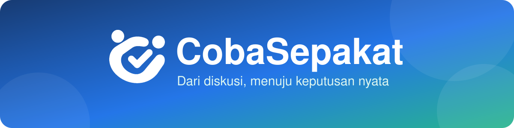

<div align="center">



<h1>CobaSepakat</h1>

</div>

<p align="center">
  Platform musyawarah berbasis <b>percobaan terukur</b> dan <b>keputusan berbasis data</b> untuk komunitas, RT/RW, dan organisasi<br>
  (perbedaan pendapat faktual, uji coba lapangan, aturan berhenti darurat).
</p>

<p align="center">
  
  
  
  
  
</p>

**Resolusi perselisihan berbasis percobaan.** Alih-alih berdebat tanpa ujung soal fakta yang bisa diuji, warga menyepakati sebuah percobaan terukur, menjalankannya dalam waktu singkat, lalu memutuskan berdasarkan data.


## 🧭 Cara kerjanya

Setiap isu berjalan melalui sembilan tahap:

1. Isu dibuka
2. Dugaan dan bukti dikumpulkan
3. Gerbang kelayakan (apakah aman dan layak diuji?)
4. Desain percobaan
5. Kesepakatan desain sebelum percobaan dimulai
6. Pelaksanaan (contoh: 14 hari)
7. Evaluasi hasil terhadap kriteria yang sudah disepakati
8. Keputusan resmi
9. Tinjauan lanjutan

Kriteria keberhasilan dikunci di muka, sehingga hasil tidak bisa ditafsirkan ulang sesudah data masuk.

## ✨ Fitur utama

### 🏠 Dasbor Ruang
Ringkasan isu, percobaan yang sedang berjalan, dan keputusan terbaru untuk satu ruang komunitas.


### 🧪 Isu & Percobaan
Alur lengkap satu isu: dugaan berbeda beserta bukti pengubah pendapat, hasil gerbang kelayakan, desain percobaan, pelaksanaan, hingga evaluasi.


### 📈 Dasbor Percobaan
Pusat kendali percobaan yang sedang berjalan: progres hari ke-N, aturan keputusan yang disepakati di muka, metrik lapangan terhadap garis dasar, dan status aturan berhenti darurat (guardrails).


### ➕ Buka Isu Baru
Warga dapat mengajukan pertanyaan keputusan baru langsung dari dasbor. Pemeriksa kata otomatis memperingatkan bila rumusan bernada menyudutkan (pencocokan kata utuh, jadi "kesalahan" tidak ikut ditandai).


### 📚 Pustaka Keputusan
Arsip keputusan resmi beserta dasar datanya, supaya perdebatan yang sama tidak diulang dari nol.


### 📋 Templat Uji Coba
Rancangan percobaan siap pakai untuk kasus yang sering muncul.


### 📊 Analitik Dampak
Ringkasan yang dihitung dari catatan ruang (waktu ke keputusan, keselarasan keputusan dengan hasil evaluasi, penerimaan pihak yang berseberangan, pergeseran keyakinan), selalu dengan ukuran sampel dan interval. Tanpa data tampil "belum ada data". Ekspor CSV.


### 🤝 Layanan Fasilitasi
Direktori fasilitator untuk isu yang butuh pendamping netral.


### 🔍 Log Audit
Jejak setiap perubahan penting dalam rantai hash SHA-256. Tombol verifikasi mendeteksi entri yang diubah, dihapus, atau ditukar.


### 📱 Responsif
Landing page dan demo tampil nyaman di layar ponsel (diperiksa pada 375, 820, dan 1280 px tanpa overflow horizontal). Form dan dialog memakai label terhubung, nama aksesibel, dan dapat ditutup dengan Escape.


## 🔬 Cara hasil dihitung (dan batasnya)

Seluruh logika keputusan ada di `src/core` (TypeScript murni, tanpa React/DOM/Supabase, dijaga oleh test kemurnian).

| Modul | Isi |
| --- | --- |
| `stats.ts` | rata-rata, varians, distribusi t Student, interval kepercayaan rata-rata, interval Wilson untuk proporsi. Diverifikasi terhadap nilai tabel baku dan simulasi cakupan (~95%). |
| `results.ts` | taksiran per metrik, evaluasi kriteria, gabungan `all` / `any` / `k_of_n`. Hasil selalu `terpenuhi`, `tidak_terpenuhi`, atau `belum_dapat_disimpulkan`. |
| `stopRules.ts` | aturan berhenti otomatis dari data (batas + jumlah pengamatan berturut-turut). Sifat *latching*: sekali terpicu tidak kembali aman. |
| `quorum.ts` | kuorum bilangan bulat `ceil(pemilih x persen / 100)`, suara terakhir per pengguna. |
| `design.ts` | validasi desain (durasi, ambang, kriteria, aturan berhenti, plafon anggaran). |
| `ledger.ts` | rantai hash, JSON kanonik, verifikasi. |
| `invite.ts` | token undangan 192 bit, hash token, status undangan. |
| `acceptance.ts` | ringkasan survei penerimaan dan pergeseran keyakinan. Tanpa responden, semua `null` (tidak ada angka bawaan). |

**Aturan keputusan.** Kriteria terstruktur (metrik, pembanding, ambang absolut atau perubahan relatif, jumlah hari minimum) dikunci sebelum data masuk. Sebuah kriteria `terpenuhi` hanya bila **seluruh** interval kepercayaan 95% berada di sisi yang lolos. Bila interval melintasi ambang, hasilnya `belum_dapat_disimpulkan`, walau taksiran titik tampak lolos. Aplikasi tidak pernah memakai kata "pasti" atau "signifikan".

**Batas metode yang harus dibaca (ditampilkan juga di UI dan PDF):**

1. Satuan analisis adalah rata-rata harian dan dianggap independen antar hari. Tren, hari kerja vs akhir pekan, dan cuaca melanggar anggapan ini.
2. Garis dasar dianggap angka tetap tanpa ketidakpastian, sehingga interval perubahan relatif cenderung terlalu sempit.
3. Tidak ada kelompok pembanding paralel (bukan uji acak berkelompok kontrol): perubahan tidak bisa dipisahkan dari faktor lain.
4. Metrik skala survei 1 sampai 5 diperlakukan sebagai angka interval, kasar untuk data ordinal.
5. Beberapa metrik dinilai bersamaan tanpa koreksi perbandingan ganda.
6. Survei penerimaan bersifat sukarela, sampel kecil, dan tidak mewakili seluruh warga.
7. `rentang_tetap` ditafsirkan sebagai: selisih rata-rata dari garis dasar tidak boleh melebihi ambang (keputusan desain yang perlu dicek).

## 🏗️ Arsitektur

```
src/core        logika keputusan murni (diuji unit + property-based)
src/lib         adapter tipe aplikasi <-> core, laporan PDF, undangan lokal
src/backend     adapter Supabase (klien disuntik) + konfigurasi env
src/components  UI React (Tailwind 4, Recharts untuk grafik)
src/i18n        kamus id (bawaan) dan en
supabase/       migrasi SQL (skema + RLS + buku besar) dan test RLS (PGlite)
e2e/            Playwright (alur, axe, 360px, PWA)
```

**Mengapa tetap Vite, bukan Next.js?** Tidak ada kebutuhan SSR nyata: tautan undangan dan data keputusan hanya bermakna setelah login (RLS), mode demo harus berjalan tanpa server, dan hosting statis di Vercel cukup. Bila kelak ada halaman keputusan publik yang perlu SEO, tambahkan fungsi edge terpisah tanpa memigrasi seluruh aplikasi.

### Dua mode

| | Mode demo (bawaan) | Mode tim (Supabase) |
| --- | --- | --- |
| Akun | tidak perlu | email (tautan sekali pakai) |
| Data | fiktif, di `localStorage`; sinkron antar tab lewat event `storage` | Postgres bersama, Realtime |
| Peran | pemilih persona contoh | `creator` / `participant` / `observer` ditegakkan RLS |
| Undangan | lokal di peramban | tabel `invites` + `redeem_invite()` |
| Riwayat | rantai hash di klien | rantai hash dihitung server, tidak bisa diubah |

Mode tim aktif bila `VITE_SUPABASE_URL` dan `VITE_SUPABASE_ANON_KEY` terisi (lihat `.env.example`).

> **Status jujur mode tim:** skema, RLS, kuorum server, dan buku besar diuji dengan 29 test di PGlite (Postgres WASM). Adapter `src/backend` diuji dengan klien tiruan. **Belum dijalankan terhadap proyek Supabase sungguhan** (tidak ada kredensial di lingkungan pengembangan). Sebelum produksi: jalankan migrasi di proyek uji, ulangi test RLS terhadapnya, dan uji alur login/undangan/Realtime secara manual.

## 🗄️ Model data

`profiles`, `spaces`, `memberships(role)`, `invites(token_hash)`, `issues`, `claims`, `comments`, `experiments(design jsonb)`, `approvals`, `data_entries`, `acceptance_responses`, `ledger_entries`.

Peran per ruang:

| Peran | Hak |
| --- | --- |
| `creator` | mengelola ruang, undangan, membuat desain (sebelum disepakati), mencatat keputusan |
| `participant` | dugaan, komentar, suara desain, catat data, verifikasi data orang lain, "Hentikan Sekarang" |
| `observer` | hanya baca |

Dijamin di database (dan diuji): orang luar tidak melihat apa pun; kuorum dihitung server (`ceil(pemilih x persen)`), percobaan mulai otomatis saat tercapai dan desain terkunci (juga bagi pemilik tabel, lewat trigger); data hanya bisa dicatat saat percobaan berjalan dan tidak bisa diubah/dihapus langsung; pencatat tidak bisa memverifikasi entrinya sendiri; buku besar hanya bisa ditambah (UPDATE/DELETE/TRUNCATE ditolak trigger) dan `verify_ledger()` mendeteksi perusakan. Batas: perusak berhak superuser yang menonaktifkan trigger *dapat* mengubah data, tetapi terdeteksi oleh verifikasi rantai kecuali ia menulis ulang seluruh rantai, jadi jangkarkan hash ujung di luar database.

## 🔒 Privasi

- Mode demo tidak mengirim data ke mana pun. Semua tersimpan di peramban Anda (`localStorage`), dapat dihapus lewat tombol reset atau data situs.
- Mode tim menyimpan nama tampilan, email (di Supabase Auth), dan isi musyawarah. Hanya anggota ruang yang dapat membacanya (RLS). Token undangan tidak disimpan, hanya hash-nya.
- Hanya kunci anon yang dipakai di klien. **Jangan** menaruh `service_role` di variabel `VITE_*`.
- Font dimuat dari Google Fonts; ganti dengan font lokal bila itu bermasalah bagi kebijakan privasi Anda.
- Dokumen ini bukan nasihat hukum. Penyelarasan dengan UU PDP perlu ditinjau oleh pihak yang berwenang sebelum dipakai untuk data warga nyata.

## ♿ Aksesibilitas, bahasa, offline

- Kontras warna diuji axe (WCAG 2 A/AA) di 6 layar pada desktop dan 360px. Status hasil memakai ikon + teks, bukan warna saja. Grafik punya ringkasan teks dan tabel data setara.
- Diperiksa tanpa gulir horizontal di lebar 360px.
- Bahasa: Indonesia (bawaan) dan English. Navigasi, layar hasil, verifikasi riwayat, undangan, dan laporan diterjemahkan; layar lain masih berbahasa Indonesia dan jatuh kembali ke teks itu.
- PWA: shell aplikasi bekerja luring lewat service worker. Data mode tim tidak pernah di-cache.

## 🛠️ Teknologi

React 19, TypeScript, Vite, Tailwind 4, Recharts, jsPDF, Supabase (opsional), Vitest + fast-check, PGlite, Playwright + axe, Biome.

## 🚀 Menjalankan secara lokal

Prasyarat: Node.js 20 atau lebih baru.

```bash
npm install
npm run dev            # http://localhost:3000
npm run verify         # lint + typecheck + test + build
npm run test:coverage  # unit, property-based, dan test RLS, dengan ambang cakupan core
npm run e2e            # Playwright (desktop dan 360px); perlu Chromium
```

Untuk mode tim: salin `.env.example` ke `.env.local`, isi URL dan kunci anon proyek Supabase Anda, lalu jalankan `supabase/migrations/20261112000000_init.sql` di proyek itu (SQL editor atau `supabase db push`).

## ▲ Deploy ke Vercel

Impor repositori; `vercel.json` sudah memuat preset Vite dan header keamanan. Variabel lingkungan opsional: `VITE_SUPABASE_URL`, `VITE_SUPABASE_ANON_KEY`. CI (`.github/workflows/ci.yml`) menjalankan lint, typecheck, test, build, dan E2E pada setiap push dan PR.

## 📌 Batasan yang masih ada

- Mode tim belum diuji terhadap Supabase sungguhan (lihat di atas); UI mode tim baru mencakup halaman undangan dan adapter, belum seluruh alur data.
- Sinkron antar tab di mode demo tidak menggabungkan perubahan: penulisan bersamaan dari dua tab, yang terakhir menang.
- Sebagian teks UI belum diterjemahkan ke English.
- Data demo adalah fiktif. Tanggal percobaan contoh digeser agar hari ini selalu hari ke-8.

## 👤 Author & License

Created by Vassel Goleyu. Copyright (c) 2026 Vassel Goleyu. All rights reserved.
