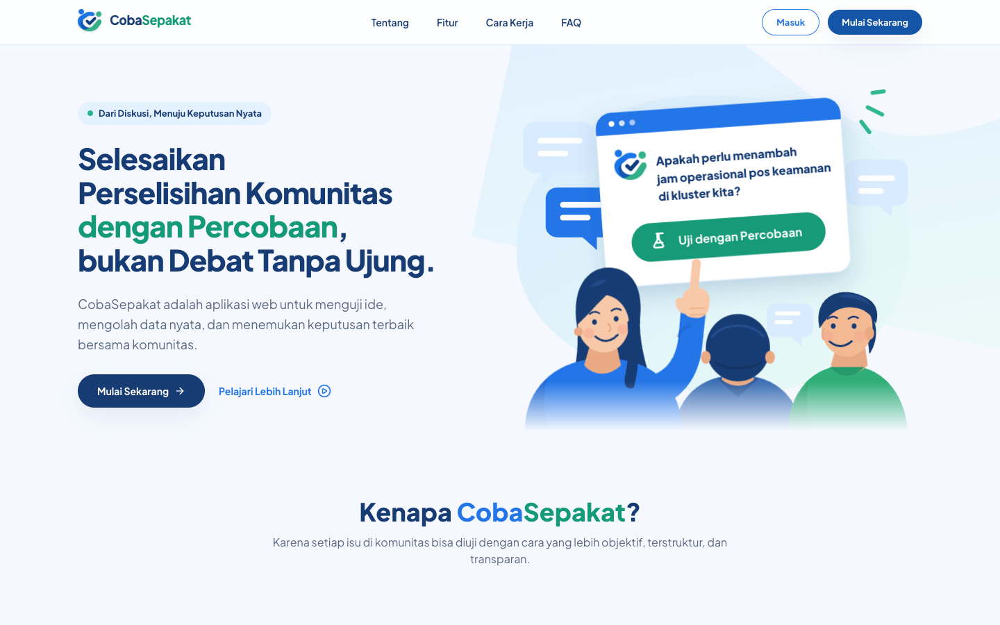
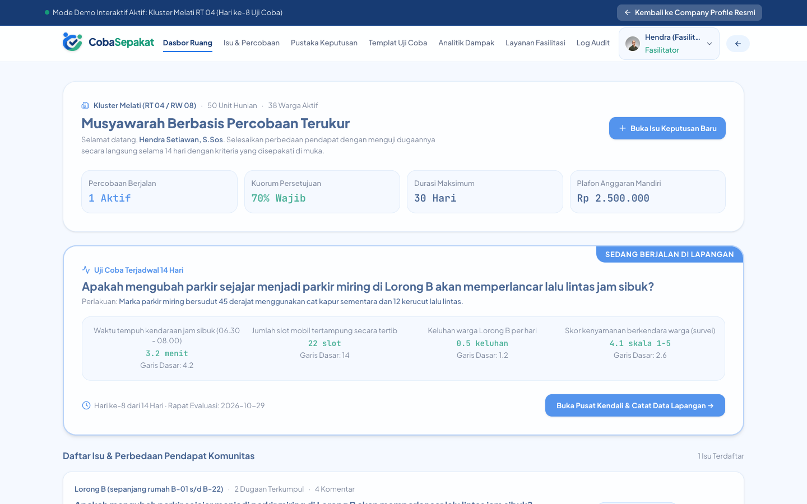
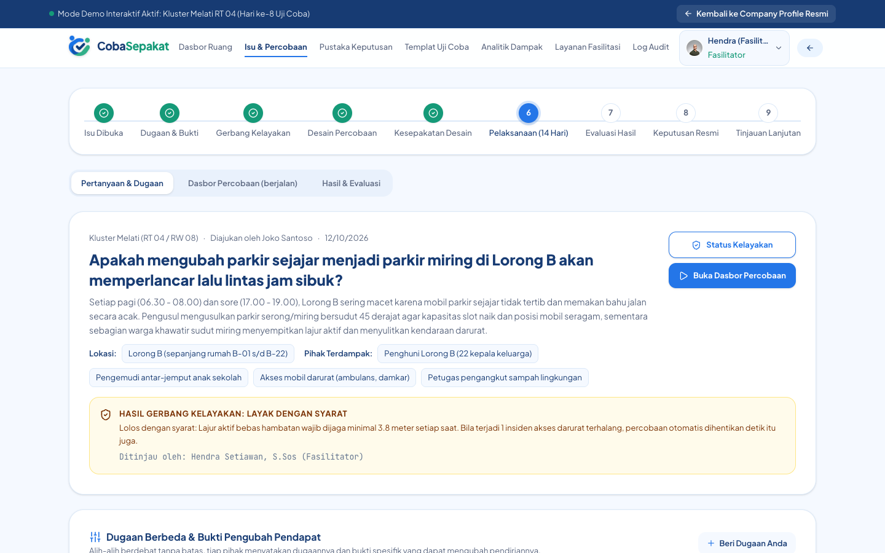
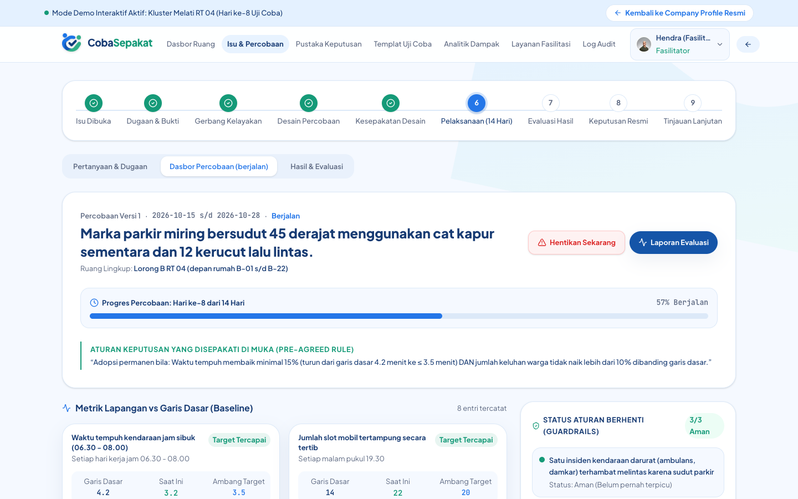
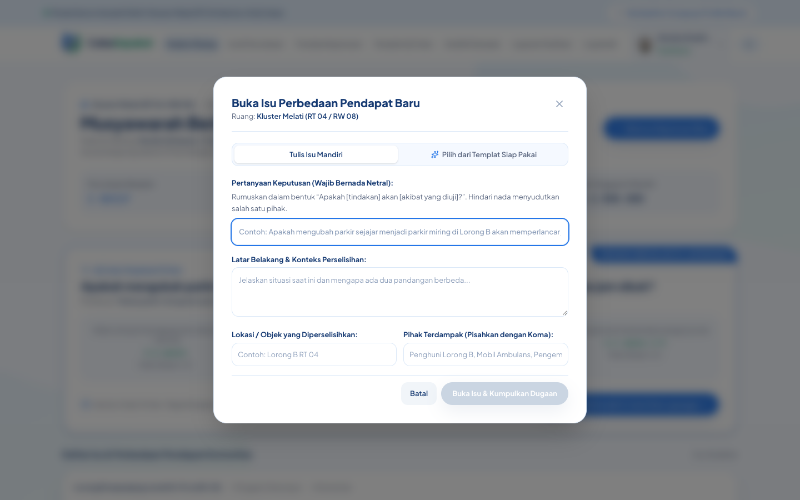
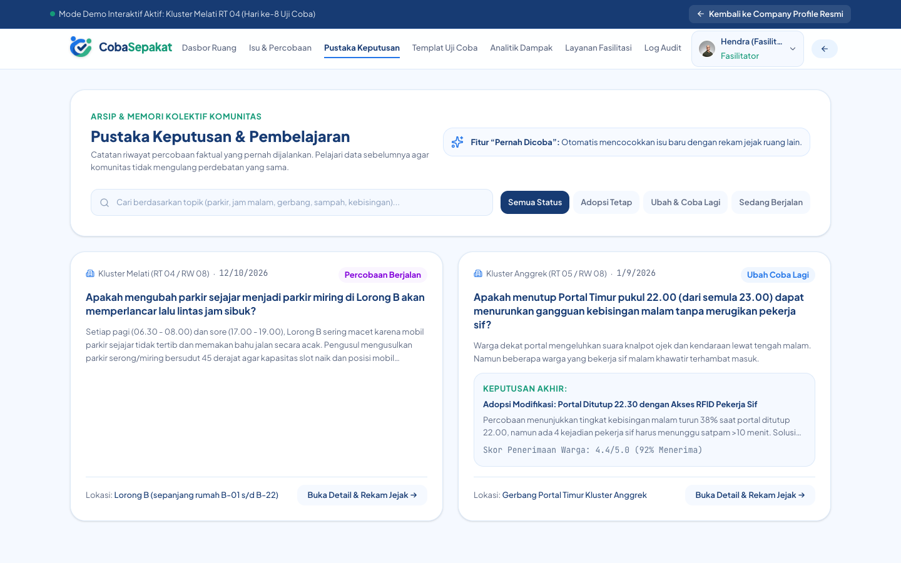
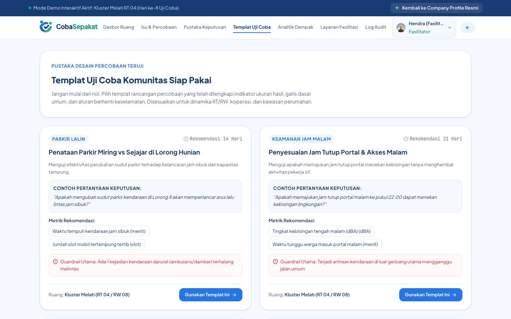
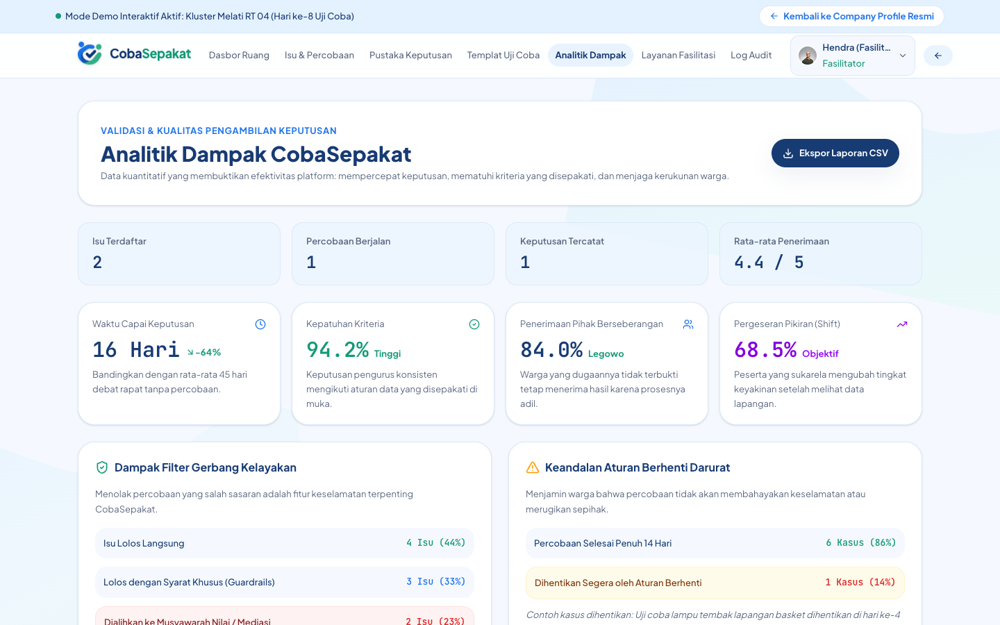
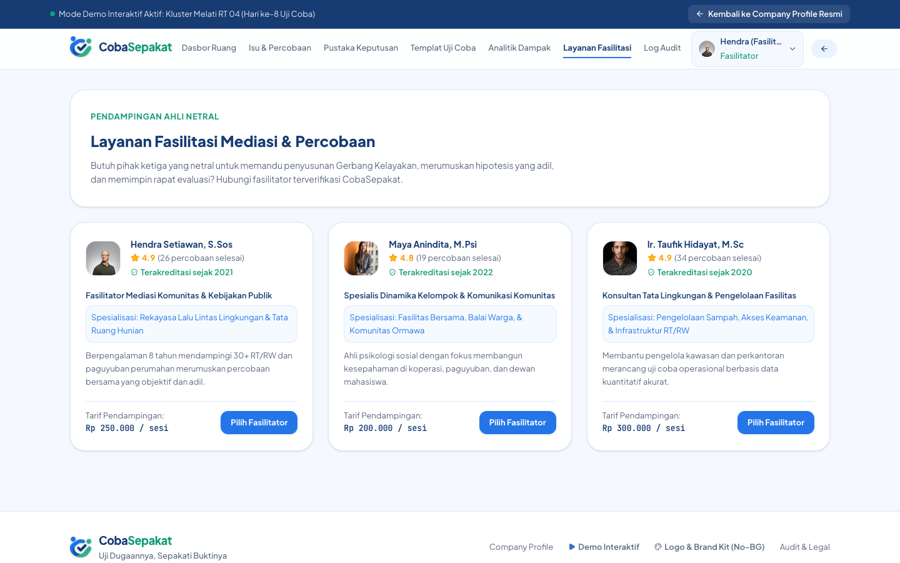
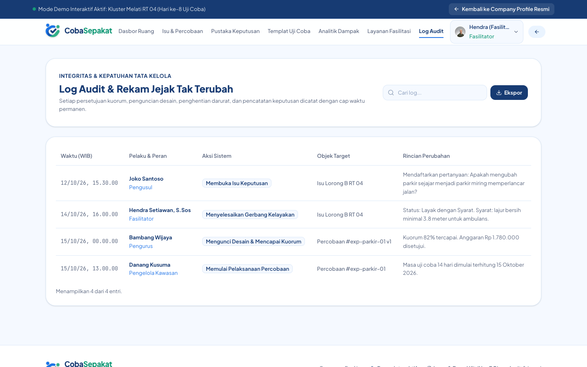

<div align="center">

<picture>
  <source media="(prefers-color-scheme: dark)" srcset="public/brand/cobasepakat-horizontal-white-nobg.png">
  
</picture>

<h1>CobaSepakat</h1>

</div>

<p align="center">
  Platform musyawarah berbasis <b>percobaan terukur</b> dan <b>keputusan berbasis data</b> untuk komunitas, RT/RW, dan organisasi<br>
  (perbedaan pendapat faktual, uji coba lapangan, aturan berhenti darurat).
</p>

<p align="center">
  
  
  
  
  
</p>

**Resolusi perselisihan berbasis percobaan.** Alih-alih berdebat tanpa ujung soal fakta yang bisa diuji, warga menyepakati sebuah percobaan terukur, menjalankannya dalam waktu singkat, lalu memutuskan berdasarkan data.



## Cara kerjanya

Setiap isu berjalan melalui sembilan tahap:

1. Isu dibuka
2. Dugaan dan bukti dikumpulkan
3. Gerbang kelayakan (apakah aman dan layak diuji?)
4. Desain percobaan
5. Kesepakatan desain sebelum percobaan dimulai
6. Pelaksanaan (contoh: 14 hari)
7. Evaluasi hasil terhadap kriteria yang sudah disepakati
8. Keputusan resmi
9. Tinjauan lanjutan

Kriteria keberhasilan dikunci di muka, sehingga hasil tidak bisa ditafsirkan ulang sesudah data masuk.

## Fitur utama

### Dasbor Ruang
Ringkasan isu, percobaan yang sedang berjalan, dan keputusan terbaru untuk satu ruang komunitas.



### Isu & Percobaan
Alur lengkap satu isu: dugaan berbeda beserta bukti pengubah pendapat, hasil gerbang kelayakan, desain percobaan, pelaksanaan, hingga evaluasi.



### Dasbor Percobaan
Pusat kendali percobaan yang sedang berjalan: progres hari ke-N, aturan keputusan yang disepakati di muka, metrik lapangan terhadap garis dasar, dan status aturan berhenti darurat (guardrails).



### Buka Isu Baru
Warga dapat mengajukan pertanyaan keputusan baru langsung dari dasbor.



### Pustaka Keputusan
Arsip keputusan resmi beserta dasar datanya, supaya perdebatan yang sama tidak diulang dari nol.



### Templat Uji Coba
Rancangan percobaan siap pakai untuk kasus yang sering muncul.



### Analitik Dampak
Waktu capai keputusan, kepatuhan terhadap kriteria, penerimaan pihak yang berseberangan, pergeseran pendapat, serta ekspor laporan CSV.



### Layanan Fasilitasi
Direktori fasilitator untuk isu yang butuh pendamping netral.



### Log Audit
Jejak setiap perubahan penting agar proses tetap transparan dan bisa dipertanggungjawabkan.



### Responsif
Landing page dan demo tampil nyaman di layar ponsel.


## Teknologi

React 19 · TypeScript · Vite · Tailwind CSS 4 · Motion · Lucide

Aplikasi ini sepenuhnya sisi klien (SPA statis). Tidak ada backend, database, atau API key; data demo disimpan di `localStorage` peramban.

## Menjalankan secara lokal

Prasyarat: Node.js 20 atau lebih baru.

```bash
npm install
npm run dev      # http://localhost:3000
npm run build    # hasil build ke dist/
npm run lint     # pengecekan tipe
```

## Deploy ke Vercel

Vercel mendeteksi Vite secara otomatis. Impor repositori ini, lalu biarkan pengaturan bawaan:

| Pengaturan | Nilai |
| --- | --- |
| Framework Preset | Vite |
| Build Command | `npm run build` |
| Output Directory | `dist` |
| Environment Variables | tidak ada |

## Author & License

Created by Vassel Goleyu. Copyright (c) 2026 Vassel Goleyu. All rights reserved.
